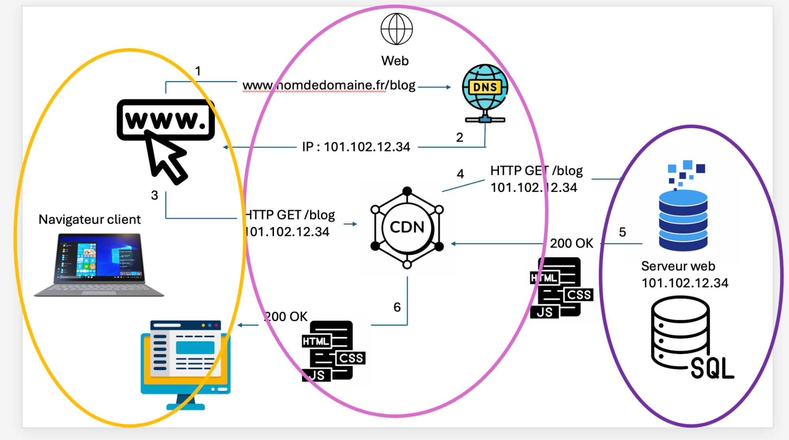

# **Comprendre et expliquer le trajet d'une page WEB**

1. **Définition des termes (partie A)**

   1. **Internet** est l'infrastructure matérielle et le réseau de transport \[[source : MDN\]](https://developer.mozilla.org/fr/docs/Learn_web_development/Howto/Web_mechanics/How_does_the_Internet_work)**.**

   2. # Le **Web** (ou World Wide Web) est simplement les voitures ou les camions (les pages et les sites) qui roulent sur cette route \[[source : Facebook Ecole Ri7](https://www.facebook.com/EcoleRi7/videos/internet-vs-web-internet-web-et-90-des-gens-confondent-les-deux-lun-est-la-route/4360412314210847/)\]**.**

   3. et  4. **Clients** et **Serveurs :** Le client est l’appareil ou le logiciel qui demande un service \[[source : MDN](https://developer.mozilla.org/fr/docs/Learn_web_development/Getting_started/Web_standards/How_the_web_works)\].  
      Le serveur est l’ordinateur ou le programme qui fournit ce service en répondant aux demandes.  
      Les ordinateurs connectés à internet sont appelés **clients** et **serveurs**. Un schéma simplifié de leur interaction peut ressembler à ceci :![Deux cercles représentant le client et le serveur. Une flèche « requête » va du client vers le serveur, et une flèche « réponse » va du serveur vers le client]
      
   5. **Un navigateur web** est un logiciel qui permet d'accéder à Internet et d'afficher des sites web (textes, images, vidéos)\[[source : Xyoos](https://cours-informatique-gratuit.fr/cours/les-navigateurs-internet/)\].  
      Il traduit le code brut des pages (HTML, CSS) en une interface visuelle et interactive.  
   6. Un **nom de domaine** est l'adresse unique d'un site internet (exemple : [google.com](http://google.com)) elle est conçue pour être facilement mémorisée par les humains \[[source : Afnic](https://www.afnic.fr/noms-de-domaine/tout-savoir/)\].  
   7. L'**hébergement** consiste à stocker des données, des sites web ou des applications sur un serveur connecté en permanence à Internet pour les rendre accessibles en ligne\[[source : KoreEdge](https://www.koredge.fr/blog/developpement/quelle-solution-hebergement-web/)\].  
   8. Le **DNS** (pour *Domain Name System*, ou Système de Noms de Domaine) est souvent comparé à l'**annuaire Internet de la planète**.  
      Son rôle est de **traduire les noms de domaine** compréhensibles par les humains (comme [google.com](http://google.com/)) en **adresses IP** numériques utilisables par les machines (comme 142.250.179.142**)** \[[source : MDN](https://developer.mozilla.org/fr/docs/Learn_web_development/Getting_started/Web_standards/How_the_web_works)\]**.**  
      Sans le **DNS**, vous devez taper une suite complexe de chiffres pour accéder à chaque site web.  
   9. Une **URL** (*Uniform Resource Locator*, ou localisateur uniforme de ressources) est l'adresse web unique qui permet de localiser et d'accéder à une ressource (page, image, document) sur Internet \[[source : MDN](https://developer.mozilla.org/fr/docs/Learn_web_development/Getting_started/Web_standards/How_the_web_works)\].

   10. # **HTTP** (pour *Hypertext Transfer Protocol*, ou protocole de transfert hypertexte) est le langage standard qui permet de faire communiquer un navigateur web (le client) et un serveur pour afficher des sites internet\[[source : MDN](https://developer.mozilla.org/fr/docs/Learn_web_development/Getting_started/Web_standards/How_the_web_works)\].

   11. **HTTPS** est la version sécurisée du protocole HTTP, utilisée pour échanger des données entre un navigateur web et un serveur. Le « S » signifie *Secure* (sécurisé)\[[source : Cloudflare](https://www.cloudflare.com/fr-fr/learning/ssl/what-is-https/)\].  
   12. Une **requête** (l’appareil demande) est une **demande d'information** adressée à un système informatique (comme une base de données, un moteur de recherche ou un serveur web**)**\[[source : MDN](https://developer.mozilla.org/fr/docs/Learn_web_development/Getting_started/Web_standards/How_the_web_works)\]**.**  
   13. Une **réponse** (le serveur renvoie) le serveur renvoie un **message** appelé **réponse** vers l'appareil de l'utilisateur.   
       Cette réponse contient :   
       	\- Un **code de statut** (par exemple, "200 OK" si tout s'est bien passé, ou le célèbre "404 Introuvable").  
       	\- Les **données demandées** (le texte, les images ou la vidéo**)**\[[source : MDN](https://developer.mozilla.org/fr/docs/Learn_web_development/Getting_started/Web_standards/How_the_web_works)\]**.**  
   14. Un **code de statut** (ou code HTTP) est un nombre à 3 chiffres envoyé par un serveur web pour indiquer à votre navigateur si sa requête a réussi, échoué ou si une action particulière est nécessaire\[[source : Puce et media](https://www.puce-et-media.com/statuts-et-gestion-http-comprendre-les-codes-de-statut-et-leur-utilisation-efficace/)\]**.**  
   15. Une **API** (*Application Programming Interface*, ou interface de programmation d'application) est un **moyen pour deux logiciels de communiquer et d'échanger des données**. \[[source : Oracle](https://www.oracle.com/fr/cloud/cloud-native/api-management/what-is-api/)\]**.**

       

        	  
2. Adresse Chiffré (partie B)  
   1. *Adresse 1 : la boutique*  
      [https\://fleurs-roussel.fr/boutique/bouquets?couleur=rouge\&tri=prix](https://fleurs-roussel.fr/boutique/bouquets?couleur=rouge&tri=prix)  
      	**Adresse Chiffrée ✅**  
   2. *Adresse 2 : le blog*  
      *Le blog contient un formulaire de commentaires.*  
      [http\://blog.fleurs-roussel.fr/2026/livraison-express](http://blog.fleurs-roussel.fr/2026/livraison-express)  
      **Adresse non Chiffrée **

   3. *Adresse 3 : le service météo*  
      [https\://api.meteo-service.fr/v1/previsions?ville=bordeaux\&jours=3](https://api.meteo-service.fr/v1/previsions?ville=bordeaux&jours=3)  
      **Adresse Chiffrée ✅**

   

3. Trajet d’une page, de la saisie de l’URL à la page interactive (partie C)  
   1. 

4. Classer les huit extraits fournis en HTML, CSS et JavaScript, et justifier chaque famille (partie D)

   1. Extrait 1  
      \<h1\>Nos bouquets de saison\</h1\>  
        
      HTML car utilisation des chevrons avec h1 pour mettre un titre.

   2. Extrait 2  
      document.querySelector('\#panier').addEventListener('click', ouvrirPanier);

      Javascript car utilisation de fonctions.

   3. Extrait 3  
      .bouquet {  
      display: flex;  
      gap: 1rem;  
      }  
        
      Javascript car utilisation de fonctions.

   4. Extrait 4  
      \  
        
      HTML car utilisation des chevrons avec img src pour mettre une image.

   5. Extrait 5  
      let total \= prixUnitaire \* quantite;  
        
      Javascript car utilisation de let pour calcul.

   6. Extrait 6  
      color: \#c0392b;  
      font-size: 1.25rem;  
        
      CSS car utilisation de mise en forme avec la couleur.  
      

   7. Extrait 7  
      \<a href="/contact"\>Nous écrire\</a\>  
        
      HTML car utilisation des chevrons avec href pour mettre un lien hypertexte.  
        
   8. Extrait 8  
      fetch('/api/stocks').then(reponse \=\> reponse.json());  
        
      Javascript car utilisation de fonctions.  
        
        
        
5. Les trois signalements  
   1. La page Livraison ne s’affiche plus  
      En cliquant sur Livraison dans le menu du site, la cliente obtient une page d’erreur avec le code  
      404, au lieu de ses conditions de livraison. La page s’affichait normalement le mois dernier.

   Plusieurs clients lui ont signalé le problème par téléphone.  
   Adresse concernée : [https\://fleurs-roussel.fr/livraison](https://fleurs-roussel.fr/livraison)

**Réponse**  
Bonjour Madame Roussel.  
La page erreur avec le code 404 signifie “page introuvable” cela veut dire que le serveur fonctionne, mais qu’il ne trouve rien à l'adresse demandée : [https\://fleurs-roussel.fr/livraison](https://fleurs-roussel.fr/livraison).

Comme elle s’affichait le mois dernier, elle a sans doute été supprimée, renommée ou déplacée, ou le lien du menu pointe vers une ancienne adresse.

Pour la faire revenir :

1. Connectez-vous à l'espace d'administration de votre site et ouvrez la liste de vos pages.  
2. Cherchez la page Livraison. Si elle est dans la corbeille ou en brouillon, republiez-la.  
3. Si elle existe mais sous une autre adresse, corrigez le lien du menu pour qu'il pointe vers elle.  
4. Si elle a disparu, recréez-la avec vos conditions de livraison.  
5. Testez en cliquant sur Livraison dans le menu.

   Si besoin de plus d’explications, n'hésitez pas à me demander.

   

   Cordialement

   

   Christophe Leroy

   Votre Développeur

   

   2. Le blog affiche « Non sécurisé »  
      En ouvrant son blog, la cliente voit la mention « Non sécurisé » à gauche de l’adresse, dans la barre  
      du navigateur. Le blog contient un formulaire de commentaires où les visiteurs laissent leur nom et  
      leur adresse email. La boutique, elle, affiche un cadenas.  
      Adresse concernée : http\://blog.fleurs-roussel.fr3. 

**Réponse**  
Bonjour Madame Roussel  
L'adresse de votre blog commence par http\:// au lieu de https\://.  
Le « s » veut dire « sécurisé ».  
Sans lui, ce que le visiteur envoie est sans protection.  
C’est un risque pour vos clients les informations ne sont pas protégées pendant l'envoi.

Pour le corriger :

1. Demandez à votre hébergeur (HébergPlus) d'activer le certificat de sécurité, souvent gratuit, pour [blog.fleurs-roussel.fr](http://blog.fleurs-roussel.fr).  
   2. Faites rediriger l'ancienne adresse http\:// vers https\://.  
      3. Vérifiez que le cadenas apparaît.

      Si besoin de plus d’explications, n'hésitez pas à me demander.

      

      Cordialement

      

      Christophe Leroy

      Votre Développeur 

      

   3. Une facture qu’elle ne comprend pas  
      La cliente a reçu deux prélèvements de deux prestataires différents :  
      Prestataire Objet Montant  
      Nomina Renouvellement du nom de domaine fleurs-roussel.fr, 1 an 14,99 € TTC / an  
      HébergPlus Offre Pro, espace de stockage du site 7,99 € TTC / mois  
      Elle pense payer deux fois la même chose et envisage de résilier la facture Nomina.  
      Avant de répondre  
      Si la cliente résilie le renouvellement du nom de domaine, que deviennent son site et ses adresses email  
      ?

**Réponse**  
Bonjour Madame Roussel  
Vous ne devez pas résilier.   
Vous ne payez pas deux fois la même chose. Le nom de domaine (Nomina, 14,99 € par an) est l'adresse [fleurs-roussel.fr](http://fleurs-roussel.fr).  
L'hébergement (HébergPlus, 7,99 € par mois) est l'espace où sont stockés votre site et ses fichiers.

Il vous faut les deux.

Si vous résiliez Nomina, votre site ne serait plus accessible à son adresse, même avec l'hébergement payé.  
Vos adresses email en @fleurs-roussel.fr cesseraient de fonctionner, et quelqu'un d'autre pourrait racheter votre adresse.  
Donc ne résiliez rien, et conservez les deux prélèvements.

Si besoin de plus d’explications, n'hésitez pas à me demander.

Cordialement

Christophe Leroy  
Votre Développeur 